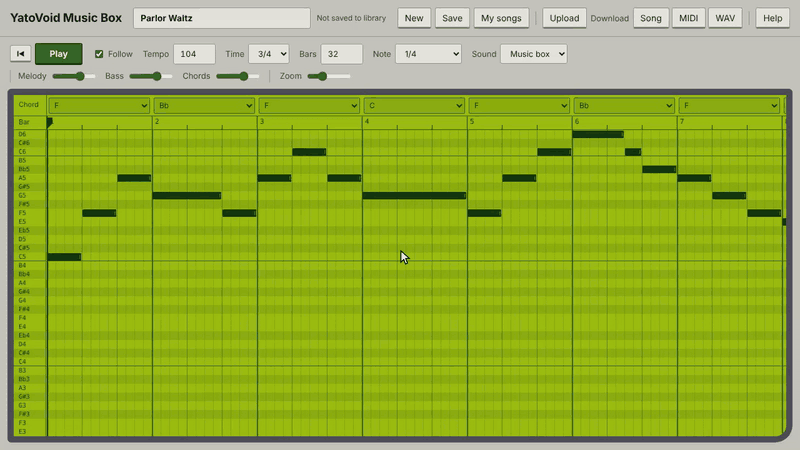

# YatoVoid Music Box

An 8-bit music editor that runs in the browser: https://yatovoid.github.io/yatovoid-music-box/

You put notes on a piano roll, pick a chord for each bar, and it plays them back with NES-style square and triangle waves. Songs can be downloaded as a WAV that loops without a gap, as a MIDI file, or as a song file you can open again later. There's nothing to install, and songs stay in your own browser.

[](https://yatovoid.github.io/yatovoid-music-box/)

The GIF has no sound. [Demo with sound (MP4, 40 seconds)](docs/demo.mp4).

The piano roll runs from C3 to C7 on a 16th-note grid. You hear each note as you place it and every pitch while you drag it. The chord picker above each bar adds a bass line and chord backing that follow the time signature, with major, minor, 7, maj7, m7, 6, sus4 and dim on all 12 roots. There are four lead sounds (Music box, Square, Soft flute, Thin chip), a volume for each of melody, bass and chords, 3/4 or 4/4 time, 40 to 240 BPM, and 1 to 64 bars.

Press **Play** to hear the example song, or **New** for an empty one. Browsers only allow sound after a click or key press, so nothing plays before that.

## Controls

| Mouse | |
| --- | --- |
| Click empty space | Adds a note, using the length set in **Note** |
| Drag a note | Moves it in time and pitch |
| Drag a note's right edge | Makes it longer or shorter |
| Shift + drag on empty space | Selects every note inside the box |
| Shift or Ctrl + click a note | Adds it to or removes it from the selection |
| Right-click or double-click a note | Deletes it |
| Right-click + drag | Erases every note the mouse passes over (one undo step) |
| Click or drag the bar numbers | Moves the playhead, also while playing |
| Drag the playhead handle or line | Places it exactly (hold Alt to turn off snapping) |
| Click a note name on the left | Plays that pitch |

| Keyboard | |
| --- | --- |
| Space | Play and pause. Pausing keeps your place. |
| Home, or the rewind button | Moves the playhead back to the start |
| Ctrl+C, Ctrl+X, Ctrl+V | Copy, cut, and paste where the mouse last was |
| Ctrl+D | Duplicates the selection right after itself |
| Ctrl+A | Selects all notes |
| Ctrl+Z, Ctrl+Y (or Ctrl+Shift+Z) | Undo and redo |
| Ctrl+S | Saves to My songs |
| Delete or Backspace | Deletes the selected notes |
| Arrow keys | Move the selection by a semitone or a 16th note |
| Shift + arrow keys | Move the selection by an octave or a beat |
| Esc | Clears the selection and closes panels |

On a Mac, use Cmd instead of Ctrl. Copy and paste work between songs.

## Saving

**Save** puts the song in **My songs** under its name, and saving again with the same name overwrites it. The song you're working on is also kept automatically if you close the tab. All of this lives in the browser's local storage, so it's tied to that browser on that computer and clearing browsing data deletes it. **Download: Song** gives you a file to back up or move, and **Upload** opens it again.

## Using a song in a game

The WAV is made to loop. With pygame:

```python
import pygame

pygame.mixer.init()
pygame.mixer.music.load("my-song.wav")
pygame.mixer.music.play(loops=-1)
```

## Song file format

Plain JSON, so scripts can write or edit songs too.

```json
{
  "format": "yatovoid-music-box",
  "version": 1,
  "name": "Parlor Waltz",
  "bpm": 104,
  "beatsPerBar": 3,
  "bars": 32,
  "lead": "musicbox",
  "volumes": { "lead": 1, "bass": 1, "chords": 1 },
  "chords": ["F", "Bb", "F", "C"],
  "notes": [{ "m": 72, "s": 0, "d": 4 }]
}
```

| Field | Meaning |
| --- | --- |
| `bpm` | Tempo, 40 to 240 |
| `beatsPerBar` | `3` or `4` |
| `bars` | Length in bars, 1 to 64 |
| `lead` | `musicbox`, `square`, `soft` or `chip` |
| `volumes` | Mixer levels from 0 to 1.5 |
| `chords` | One chord per bar, for example `"C"`, `"Am"`, `"G7"`, `"Fmaj7"`, `"Dm7"`, `"C6"`, `"Dsus4"`, `"Bdim"`. `""` means no chord. |
| `notes[].m` | MIDI note number, 48 (C3) to 96 (C7) |
| `notes[].s` | Start, in 16th notes from the beginning of the song |
| `notes[].d` | Length in 16th notes |

## MIDI

Exported MIDI files have three tracks (Melody, Chords, Bass) plus tempo and time signature. Imports can be type 0 or type 1. Every non-drum note becomes a melody note, moved by octaves into C3 to C7 if needed, and the chords start empty.

## How the sound is made

There are no samples. The lead sounds are pulse waves at 12.5%, 25% and 50% duty cycle and the bass is a 4-bit stepped triangle, as on the NES, followed by a one-beat echo and a low-pass filter. A background worker renders the whole song into one buffer, and that buffer is both what you hear and what the WAV contains. Notes still ringing at the end carry over into the start, which is why the export loops cleanly.

## Running it locally

Clone the repo and open `index.html`. There is no build step.

```
index.html      layout and controls
css/style.css   styles, light and dark
js/synth.js     sound engine, chords, WAV encoding
js/midi.js      MIDI import and export
js/demos.js     example songs
js/app.js       editor, playback, library, shortcuts
```

Issues and pull requests are welcome. Works in current Chrome, Edge, Firefox and Safari.

[MIT](LICENSE)
