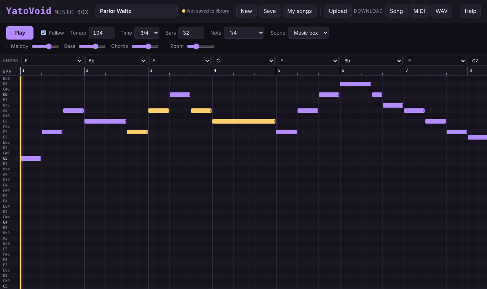

# YatoVoid Music Box

A free 8-bit music editor that runs entirely in your browser. Write chiptune melodies on a piano roll, pick a chord for each bar to get an automatic bass line and backing, and export the result as a seamless looping WAV, a MIDI file, or a song file you can open again later.

No install, no account, no server. Everything happens on your computer.



## Features

- **Piano roll editor** from C3 to C7 on a 16th-note grid, with zoom.
- **Hear while you edit:** notes play as you place them, and you hear every pitch while dragging.
- **Move, resize, select:** drag notes, stretch them from the right edge, box-select with Shift.
- **Copy, cut, paste and duplicate** notes, including between songs.
- **Undo and redo** for every change (up to 200 steps).
- **Automatic backing:** choose a chord per bar (major, minor, 7th, maj7, m7, 6th, sus4, dim) and the editor adds a triangle bass and chord stabs that follow the time signature.
- **Four lead sounds:** Music box, Square, Soft flute and Thin chip.
- **Mixer:** separate volume for melody, bass and chords.
- **3/4 and 4/4**, tempo 40–240 BPM, 1–64 bars.
- **Seamless loops:** anything still ringing at the end of the song wraps around to the start, so exported audio loops without a click. Useful for game background music.
- **My songs library** saved in your browser, plus three example songs.
- **Upload** `.json` song files or `.mid` MIDI files.
- **Download** as a song file (`.json`), MIDI (`.mid`) or audio (`.wav`).
- Light and dark themes that follow your system setting.

## Try it

Open the GitHub Pages site for this repository, or run it locally:

```bash
git clone https://github.com/<your-username>/yatovoid-music-box.git
cd yatovoid-music-box
```

Then open `index.html` in Chrome, Edge or Firefox. It works straight from the file, with no build step. If you prefer a local server:

```bash
python3 -m http.server 8000
# then visit http://localhost:8000
```

## How to use it

### Mouse

| Action | Result |
| --- | --- |
| Click empty space | Add a note using the length chosen in **Note** |
| Drag a note | Move it in time and pitch (you hear each new pitch) |
| Drag a note's right edge | Make it longer or shorter |
| Shift + drag on empty space | Select a group of notes |
| Shift or Ctrl + click a note | Add it to or remove it from the selection |
| Right-click or double-click a note | Delete it |
| Click the bar numbers | Choose where playback starts |
| Click a key name on the left | Hear that pitch |

### Keyboard

| Keys | Result |
| --- | --- |
| `Space` | Play / stop |
| `Ctrl+C` / `Ctrl+X` / `Ctrl+V` | Copy, cut, paste (pastes where the mouse last was) |
| `Ctrl+D` | Duplicate the selection right after itself |
| `Ctrl+A` | Select all notes |
| `Ctrl+Z` / `Ctrl+Y` (or `Ctrl+Shift+Z`) | Undo / redo |
| `Ctrl+S` | Save to My songs |
| `Delete` / `Backspace` | Delete selected notes |
| Arrow keys | Move the selection by a semitone or a 16th note |
| `Shift` + arrow keys | Move by an octave or a beat |
| `Esc` | Clear the selection and close panels |

On macOS use `Cmd` instead of `Ctrl`.

### Saving your work

- **Save** stores the current song in **My songs**, using the song name. Saving again with the same name updates it.
- The song you are working on is also kept automatically, so it is still there when you reopen the page.
- Songs live in your browser's local storage, on that computer and in that browser only. Clearing site data removes them, so use **Download → Song** to keep a backup or move songs to another computer, and **Upload** to open them again.

### Using the music in a game

Download the **WAV**. The file is a seamless loop, so set your engine to repeat it. For example, with Python and pygame:

```python
import pygame
pygame.mixer.init()
pygame.mixer.music.load("my-song.wav")
pygame.mixer.music.play(loops=-1)
```

## Song file format

Song files are plain JSON:

```json
{
  "format": "yatovoid-music-box",
  "version": 1,
  "name": "Parlor Waltz",
  "bpm": 104,
  "beatsPerBar": 3,
  "bars": 32,
  "lead": "musicbox",
  "volumes": { "lead": 1, "bass": 1, "chords": 1 },
  "chords": ["F", "Bb", "F", "C", "..."],
  "notes": [{ "m": 72, "s": 0, "d": 4 }]
}
```

| Field | Meaning |
| --- | --- |
| `bpm` | Tempo, 40–240 |
| `beatsPerBar` | `3` or `4` |
| `bars` | Song length in bars, 1–64 |
| `lead` | `musicbox`, `square`, `soft` or `chip` |
| `volumes` | Mixer levels, 0–1.5 |
| `chords` | One chord per bar, such as `"C"`, `"Am"`, `"G7"`, `"Fmaj7"`, `"Dm7"`, `"C6"`, `"Dsus4"`, `"Bdim"`, or `""` for none |
| `notes[].m` | MIDI note number, 48 (C3) to 96 (C7) |
| `notes[].s` | Start position in 16th notes from the beginning of the song |
| `notes[].d` | Length in 16th notes |

### MIDI

- **Export** writes three tracks: Melody, Chords and Bass, with tempo and time signature.
- **Import** reads type 0 and type 1 MIDI files. Every note except drums becomes an editable melody note, moved into the C3–C7 range if needed. Chords are left empty so you can choose them yourself.

## How the sound works

All audio is generated in plain JavaScript; there are no samples. Melodies use pulse waves at different duty cycles (12.5%, 25%, 50%) and a stepped 4-bit triangle like the NES. The bass is the same triangle. The mix gets a short echo timed to one beat and a gentle low-pass filter, then is normalised. Rendering is done ahead of time into a buffer, which is what you hear on playback and what gets saved as WAV, so the download always matches what you heard.

## Project structure

```
index.html        Page layout and controls
css/style.css     Styles and light/dark themes
js/synth.js       Sound engine, chords, WAV encoding
js/midi.js        MIDI import and export
js/demos.js       Example songs
js/app.js         Editor, playback, library, keyboard shortcuts
docs/             Screenshot used in this README
```

## Publishing with GitHub Pages

1. Push this repository to GitHub.
2. Open **Settings → Pages**.
3. Under **Build and deployment**, choose **Deploy from a branch**, select `main` and `/ (root)`, then **Save**.
4. After a minute the editor is live at `https://<your-username>.github.io/yatovoid-music-box/`.

## Browser support

Works in current versions of Chrome, Edge, Firefox and Safari. Audio starts after your first click or key press, as browsers require.

## License

[MIT](LICENSE)
