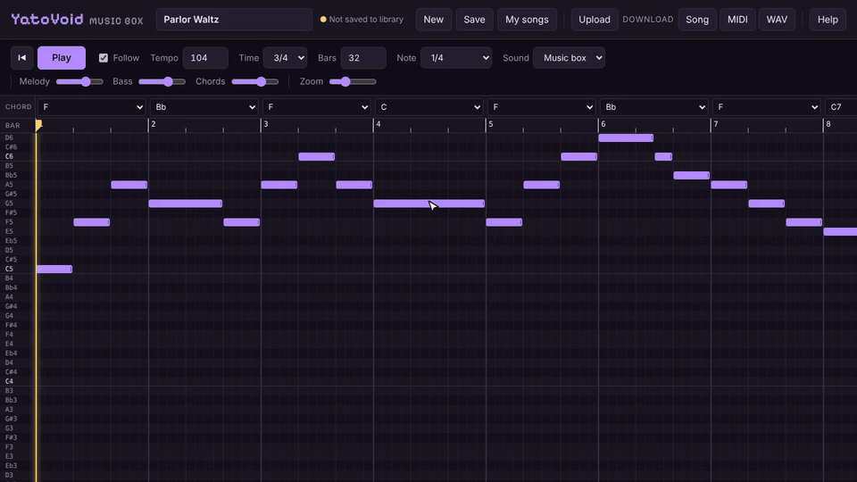

# YatoVoid Music Box

An 8-bit music editor that runs in the browser. Put notes on a piano roll, choose a chord for each bar, and it plays them back with NES-style square and triangle waves. When you're done, download the song as a WAV that loops cleanly, as a MIDI file, or as a song file you can open again later.

It's free and there's nothing to install. Your songs stay on your own computer.

**Open it here: https://yatovoid.github.io/yatovoid-music-box/**

[](https://yatovoid.github.io/yatovoid-music-box/)

The animation above has no sound. [Watch the demo with sound (MP4, 40 seconds)](docs/demo.mp4).

## What it does

- Piano roll from C3 to C7 on a 16th-note grid, with zoom.
- You hear each note when you place it, and every pitch while you drag it.
- Drag notes to move them, drag the right edge to resize, Shift-drag to select a group.
- Copy, cut, paste and duplicate, including between songs.
- Right-click to delete a note, or right-click and drag to erase everything you pass over.
- Undo and redo for every change.
- Pick a chord per bar and it adds a bass line and chord backing that follow the time signature. Major, minor, 7, maj7, m7, 6, sus4 and dim chords are available on all 12 roots.
- Four lead sounds: Music box, Square, Soft flute and Thin chip.
- Separate volume for melody, bass and chords.
- 3/4 or 4/4, 40 to 240 BPM, 1 to 64 bars.
- A playhead you can drag anywhere, even while the song is playing.
- WAV exports loop without a gap or click, which makes them easy to use as game background music.
- A song library saved in your browser, plus three example songs to start from.
- Upload `.json` song files or `.mid` files. Download as song file, MIDI or WAV.
- Light and dark themes that follow your system setting.

## Getting started

1. Open https://yatovoid.github.io/yatovoid-music-box/
2. Press **Play** to hear the example song, or **New** to start with an empty one.
3. Click the grid to add notes and choose a chord above each bar.
4. Give the song a name and press **Save**.
5. Press **Download: WAV** when you want the audio.

**My songs** lists everything you've saved plus the examples. **Help** shows all the controls.

## Controls

### Mouse

| Action | What it does |
| --- | --- |
| Click empty space | Adds a note, using the length set in **Note** |
| Drag a note | Moves it in time and pitch |
| Drag a note's right edge | Makes it longer or shorter |
| Shift + drag on empty space | Selects every note inside the box |
| Shift or Ctrl + click a note | Adds it to or removes it from the selection |
| Right-click or double-click a note | Deletes it |
| Right-click + drag | Erases every note the mouse passes over (one undo step) |
| Click or drag the bar numbers | Moves the playhead, also while playing |
| Drag the playhead handle or line | Places it exactly (hold Alt to turn off snapping) |
| Click a note name on the left | Plays that pitch |

### Keyboard

| Keys | What it does |
| --- | --- |
| Space | Play and pause. Pausing keeps your place. |
| Home, or the rewind button | Moves the playhead back to the start |
| Ctrl+C, Ctrl+X, Ctrl+V | Copy, cut, and paste where the mouse last was |
| Ctrl+D | Duplicates the selection right after itself |
| Ctrl+A | Selects all notes |
| Ctrl+Z, Ctrl+Y (or Ctrl+Shift+Z) | Undo and redo |
| Ctrl+S | Saves to My songs |
| Delete or Backspace | Deletes the selected notes |
| Arrow keys | Move the selection by a semitone or a 16th note |
| Shift + arrow keys | Move the selection by an octave or a beat |
| Esc | Clears the selection and closes panels |

On a Mac, use Cmd instead of Ctrl.

## Saving and sharing songs

**Save** puts the current song in **My songs** under its name. Saving again with the same name overwrites it. The song you're working on is also kept automatically, so it's still there if you close the tab.

Saved songs live in your browser's local storage. They're only on that computer, in that browser, and clearing your browsing data deletes them. To keep a backup or move a song to another computer, use **Download: Song** and open the file later with **Upload**.

## Using a song in a game

Download the WAV and set it to loop in your engine. With Python and pygame:

```python
import pygame

pygame.mixer.init()
pygame.mixer.music.load("my-song.wav")
pygame.mixer.music.play(loops=-1)
```

## Song file format

Song files are plain JSON, so you can also generate or edit them with your own scripts.

```json
{
  "format": "yatovoid-music-box",
  "version": 1,
  "name": "Parlor Waltz",
  "bpm": 104,
  "beatsPerBar": 3,
  "bars": 32,
  "lead": "musicbox",
  "volumes": { "lead": 1, "bass": 1, "chords": 1 },
  "chords": ["F", "Bb", "F", "C"],
  "notes": [{ "m": 72, "s": 0, "d": 4 }]
}
```

| Field | Meaning |
| --- | --- |
| `bpm` | Tempo, 40 to 240 |
| `beatsPerBar` | `3` or `4` |
| `bars` | Length in bars, 1 to 64 |
| `lead` | `musicbox`, `square`, `soft` or `chip` |
| `volumes` | Mixer levels from 0 to 1.5 |
| `chords` | One chord per bar, for example `"C"`, `"Am"`, `"G7"`, `"Fmaj7"`, `"Dm7"`, `"C6"`, `"Dsus4"`, `"Bdim"`. Use `""` for no chord. |
| `notes[].m` | MIDI note number, 48 (C3) to 96 (C7) |
| `notes[].s` | Start, counted in 16th notes from the beginning of the song |
| `notes[].d` | Length in 16th notes |

## MIDI

Exported MIDI files have three tracks (Melody, Chords and Bass) plus the tempo and time signature, so you can take a song into a full DAW.

Imported MIDI files can be type 0 or type 1. Every note except drums becomes an editable melody note, shifted by octaves into the C3 to C7 range if needed. Chords start empty so you can choose them yourself.

## How the sound is made

There are no samples. Everything is generated in JavaScript: pulse waves at 12.5%, 25% and 50% duty cycle for the lead sounds, and a 4-bit stepped triangle wave for the bass, like the NES. The mix gets a short echo one beat long and a gentle low-pass filter.

The song is rendered into a buffer in a background worker, and that buffer is what you hear and what gets saved, so the WAV always sounds exactly like playback. Notes still ringing at the end of the song carry over into the beginning, which is why exports loop cleanly.

## Running it offline

```bash
git clone https://github.com/YatoVoid/yatovoid-music-box.git
```

Then open `index.html` in your browser. There's no build step and nothing to install.

## Project layout

```
index.html        Page layout and controls
css/style.css     Styles and light/dark themes
js/synth.js       Sound engine, chords, WAV encoding
js/midi.js        MIDI import and export
js/demos.js       Example songs
js/app.js         Editor, playback, song library, keyboard shortcuts
docs/             Demo video and screenshot
```

## Contributing

Bug reports and ideas are welcome in [Issues](https://github.com/YatoVoid/yatovoid-music-box/issues), and so are pull requests. The app is plain HTML, CSS and JavaScript with no dependencies, so you can change a file and refresh the page to see the result.

## Browser support

Works in current Chrome, Edge, Firefox and Safari. Browsers only allow sound after you click or press a key, so playback starts on your first interaction.

## License

[MIT](LICENSE)
